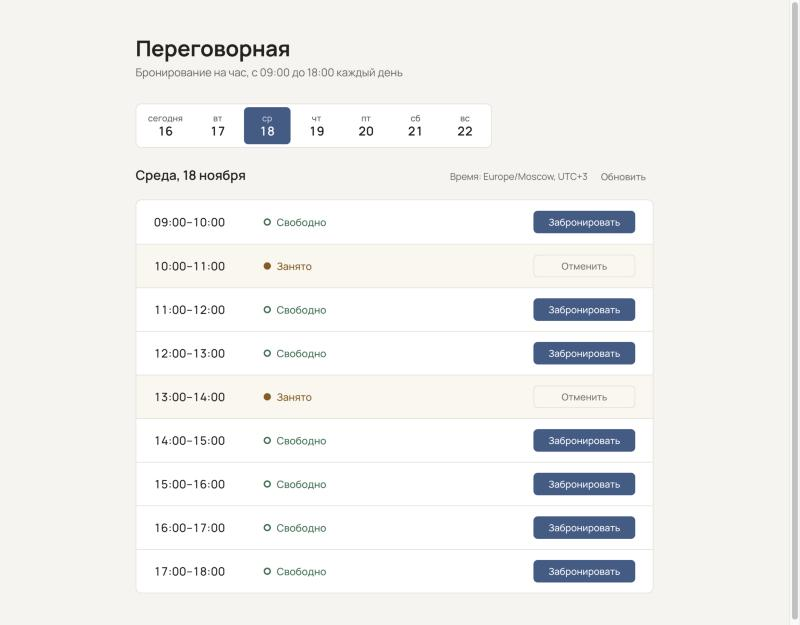
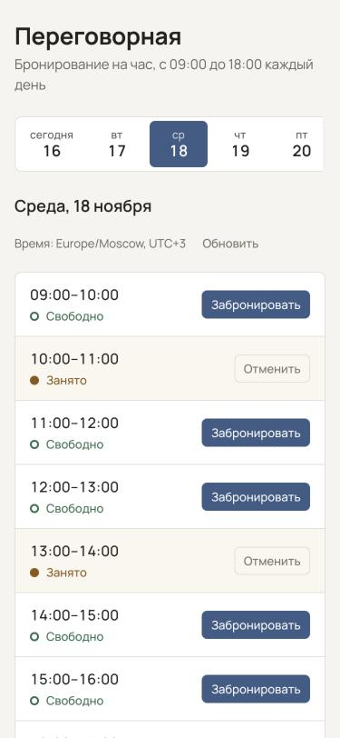

# Mini Booking — бронирование переговорной

Одна переговорная, часовые слоты 09:00–18:00 каждый день, включая выходные.
Laravel JSON API + одностраничный интерфейс на Vue 3 и PrimeVue.

| Ноутбук | Телефон (375 px) |
| --- | --- |
|  |  |

```
backend/   Laravel 13 (API, миграции, сидер, тесты)
frontend/  Vue 3 + Vite + TypeScript + PrimeVue 4
scripts/   concurrency-check.sh — проверка гонки на живом сервере
```

## Зависимости

- PHP **8.3+** с расширениями `pdo_sqlite`, `mbstring`. Laravel 13 требует PHP 8.3,
  поэтому это минимум, а не 8.2. Проверено на PHP 8.5.
- Composer 2
- Node.js **20.19+ или 22.12+** (требование Vite 8), npm. Проверено на Node 26.
- SQLite — встроена в PHP, отдельный сервер БД не нужен.

## Запуск

### Backend (порт 8000)

```bash
cd backend
composer install
cp .env.example .env
php artisan key:generate
touch database/database.sqlite
php artisan migrate
php artisan db:seed
php artisan serve
```

База данных — `backend/database/database.sqlite` (путь можно поменять через `DB_DATABASE`).
Часовой пояс расписания задаётся в `.env`: `APP_TIMEZONE=Europe/Moscow`.

Сидер можно запускать повторно: `php artisan db:seed`. Он только добавляет недостающие слоты.
Начать с чистой базы: `php artisan migrate:fresh --seed`.

### Frontend (порт 5173)

```bash
cd frontend
npm install
npm run dev
```

Откройте http://localhost:5173. Vite проксирует `/api` на `http://127.0.0.1:8000`
(другой адрес — через `API_PROXY_TARGET`, см. `frontend/.env.example`), поэтому CORS не нужен.

Сборка с проверкой типов: `npm run build`.

### Тесты

```bash
cd backend
php artisan test
```

Обязательные тесты из задания лежат в `tests/Feature/BookingTest.php`:

- `test_booking_a_free_future_slot_returns_201_and_stores_the_booking`
- `test_booking_an_occupied_slot_returns_409_and_keeps_a_single_booking`

Дополнительно проверяются: слот, начинающийся ровно «сейчас», — это 409;
422 по каждому полю; отмена, повторная отмена (404) и повторное бронирование;
формат списка слотов и отсутствие в нём имени/email; хранение в UTC; идемпотентность сидера.
Тесты используют SQLite в памяти и фиксированные часы (`travelTo`).

## API

| Метод | Путь | Ответ |
| --- | --- | --- |
| GET | `/api/slots` | `200` `{ data: Slot[], meta: { timezone, today, server_time } }` |
| POST | `/api/bookings` | `201 { id }` · `422 { message, errors }` · `409 { message, reason }` |
| DELETE | `/api/bookings/{id}` | `204` · `404`, если бронирования нет (в том числе при повторной отмене) |

```json
{ "id": 20, "date": "2026-11-18", "starts_at": "2026-11-18T10:00:00+03:00",
  "ends_at": "2026-11-18T11:00:00+03:00", "status": "booked", "booking_id": 1 }
```

- `status`: `free` | `booked` | `past`. Прошедший слот получает `past`, даже если у него
  есть бронирование; его `booking_id` при этом всё равно отдаётся.
- `reason` у 409: `slot_booked` или `slot_past`.
- Имена и email в список слотов не попадают.
- Отмена без авторизации — так задумано для демо. API разрешает удалить и прошедшее
  бронирование, но в интерфейсе кнопка «Отменить» есть только у будущих.

## Как обеспечена уникальность бронирования

Модель данных: одна строка в `bookings` = одно активное бронирование.
На `bookings.slot_id` стоит `UNIQUE` и внешний ключ на `slots.id`.
Отмена удаляет строку, поэтому история отмен не хранится — по заданию она не нужна.
Так ограничение «не больше одного активного бронирования на слот» выражено напрямую
в схеме, без условных индексов и флагов `cancelled_at`.

`BookingController::store` не проверяет «свободен ли слот» отдельным запросом: такая
проверка может проиграть гонку. Контроллер сразу делает `INSERT`. Из двух одновременных
вставок база примет ровно одну, вторая упадёт с нарушением уникальности. Ловится только
`UniqueConstraintViolationException` — она превращается в `409 slot_booked`.
Любая другая ошибка БД остаётся 500, а не выдаётся за «слот занят».

SQLite сериализует запись. В `config/database.php` для неё включены `busy_timeout = 5000`
и `journal_mode = WAL`, чтобы параллельные записи ждали блокировку,
а не падали с `database is locked`.

**Что проверено на самом деле.** `php artisan serve` обрабатывает запросы по одному,
поэтому на нём гонку не воспроизвести. Проверка проводилась на встроенном сервере PHP
с 8 процессами-воркерами: по 24 одновременных POST на каждый из пяти слотов.
Итог — ровно один `201` и 23 `409` на слот, в БД по одному бронированию, ошибок блокировки
не было. Повторить:

```bash
cd backend
PHP_CLI_SERVER_WORKERS=8 php -S 127.0.0.1:8001 -t public public/index.php
# в другом терминале, из корня репозитория; 30 — ID свободного будущего слота
scripts/concurrency-check.sh 30 24
```

PHPUnit-тест на 409 проверяет логику последовательно — гонку он не моделирует.

## Время

- Часовой пояс расписания — `config('app.timezone')`, то есть `APP_TIMEZONE`
  (по умолчанию `Europe/Moscow`). Часы работы и горизонт сидера — в `backend/config/booking.php`.
- Сидер строит время слота как местное время в этом поясе (09:00, 10:00, …)
  и только потом переводит его в UTC.
- В БД время лежит в **UTC** (`App\Casts\UtcDateTime`). Встроенный cast Laravel
  записал бы местное время без смещения — неоднозначно при переходе на летнее время
  и при смене `APP_TIMEZONE`.
- API отдаёт ISO 8601 со смещением в поясе расписания, плюс `date` — календарную дату
  в этом поясе — и `meta.timezone`.
- Слот считается прошедшим, когда `starts_at <= now()` по часам сервера. Правило задано
  в одном месте — `Slot::hasStarted()` — и используется и списком, и бронированием.
- Фронтенд не вычисляет даты из часового пояса браузера. Ключ фильтра — это `date` от сервера,
  время форматируется через `Intl.DateTimeFormat` с `timeZone` из `meta.timezone`.

## Интерфейс

- `src/api/bookingApi.ts` — все HTTP-вызовы и типизированные ошибки
  (`validation`, `conflict`, `not_found`, `server`, `network`).
- `src/composables/useSchedule.ts` — расписание с сервера, выбранная дата, загрузка.
- `src/composables/useBookingActions.ts` — бронирование и отмена с последующей перезагрузкой
  расписания. Оптимистичных обновлений нет: экран показывает только то, что подтвердил сервер.
- Компоненты: `DateStrip`, `SlotList`, `BookingDialog`, `CancelDialog`.

Поведение:

- Полоса из 7 дней начинается с сегодняшнего. Сохранённые даты вне окна (например, если
  сидер запускали раньше) доступны в списке «Другая дата».
- Обязательные поля проверяются в браузере. Ошибки 422 показываются у своих полей,
  введённые данные сохраняются.
- Пока запрос выполняется, кнопка заблокирована и показывает индикатор; диалог нельзя закрыть.
- 409: диалог объясняет, занят слот или уже начался, и сразу перезагружает расписание.
- Сеть или 5xx: сначала перезагружается расписание. Если слот уже занят, повтор не
  предлагается — запрос мог пройти. Иначе есть кнопка «Повторить», форма сохраняется.
- Если действие удалось, но расписание обновить не вышло, об этом сообщается отдельно,
  а само действие не считается неудачным.

Шрифт Manrope с кириллицей подключён локально через `@fontsource/manrope` (SIL OFL 1.1).

**Почему PrimeVue 4, а не 5.** PrimeVue 5 распространяется под коммерческой лицензией
PrimeUI: нужен ключ, без него может показываться уведомление. Версия 4.5.5 — под MIT,
она зафиксирована точно.

## Что проверено и что нет

Проверено:

- Вручную в браузере на чистой базе: сидер → выбор даты → бронирование → обновлённый список
  → отмена с подтверждением → повторное бронирование того же слота.
- В интерфейсе: 422 (email, который сервер отклоняет), 409 (слот занят параллельно),
  остановленный backend (ошибка, сохранённая форма, «Повторить» после перезапуска),
  ошибка первой загрузки с повтором.
- Ширина 375 px: горизонтальной прокрутки страницы нет, прокручивается только полоса дат.
- Клавиатура: фокус в диалоге, возврат фокуса после закрытия.

Не проверено:

- В браузере с другим часовым поясом напрямую не проверялось — встроенный браузер не
  эмулирует пояс. Вместо этого тот же модуль `src/utils/datetime.ts` запускался в Node
  с `TZ` от UTC−11 до UTC+14 на реальном ответе API: даты и время совпали.
- Со скринридером не тестировалось. Подписи, `aria-invalid`/`aria-describedby`
  и `role="alert"` у сообщений есть.
- Пока страница открыта, статусы сами не обновляются: слот, который начался после загрузки,
  станет «Прошло» после «Обновить» или любого действия. Сервер при этом всё равно ответит 409.
- Тёмной темы нет.
